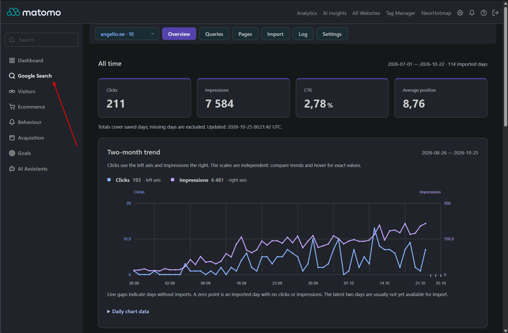

# NeorGoogleKeywords 1.1.1

[](https://matomo.org/)
[](https://php.net/)
[](LICENSE)

Imports Google Search Console web search statistics into Matomo: queries, pages, clicks, impressions, CTR and average position.

Uses a Google service account and stores aggregated search statistics separately from Matomo visit tracking.



Explore the [sections, features and practical use cases](docs/plugin-overview.md) to see how the plugin can help you understand your Google search performance.

## Features

- Daily charts and Top 20 queries for the last week and three months.
- Date filters, sortable reports and query-to-page drill-down.
- Multiple websites, manual and CLI imports, daily updates and an import log.
- Search phrases widget under Referrers → Search Engines and Keywords.
- English, Russian, French, Spanish, Portuguese, German and Italian interfaces following Matomo's language setting; English fallback.
- Custom styles in `stylesheets/custom.css`, loaded after the base stylesheet.

## Requirements

- **Matomo**: `>=5.14.0,<6.0.0`
- **PHP**: `>=8.1`, with cURL and OpenSSL.
- **Administration**: SuperUser access to configure the connection and manage imports.

## Installation

### Via Git

Clone the repository into your Matomo `plugins/` directory:

```bash
cd /path/to/matomo/plugins
git clone https://github.com/neor/Matomo-NeorGoogleKeywords.git NeorGoogleKeywords
```

### Manual Download

1. Download the release archive from [GitHub Releases](https://github.com/neor/Matomo-NeorGoogleKeywords/releases) when a release is available.
2. Extract the plugin into your Matomo installation as `plugins/NeorGoogleKeywords`. The `plugin.json` file must be directly inside that directory.
3. Ensure the web server can read the plugin files.

### Activation

Activate **NeorGoogleKeywords** under **Administration → Plugins**, or run this command from the Matomo root directory:

```bash
php console plugin:activate NeorGoogleKeywords
```

## Configuration

For step-by-step instructions, see [Google Cloud setup and JSON service-account key guide](docs/google-cloud-setup.md).

1. Enable **Google Search Console API** in [Google Cloud](https://console.cloud.google.com/).
2. Create a service account and download its JSON key.
3. Add the key's `client_email` as a user of the property in [Search Console](https://search.google.com/search-console/).
4. Store the key outside Matomo and all public web directories. Allow the PHP and cron users to read it.
5. Add this section to `config/config.ini.php`, preserving existing settings:

```ini
[NeorGoogleKeywords]
credentials_file = "/etc/matomo-secrets/google-search-console.json"
property_1 = "sc-domain:example.com"
```

The suffix in `property_1` is the **Matomo website ID**. For a URL-prefix property, use its exact URL, such as `https://www.example.org/`. Each mapping imports the entire Search Console property.

On Windows, use an existing local path such as `C:/private/google-search-console.json`. Never include the key in Git or release archives.

Open **Google Search → Import → Test connection** to verify access.

## Imports

The web form imports up to **7 days** at a time. For historical data or large websites, use the CLI:

```bash
php console neor-gkeys:import --idsite=1 --from=2026-09-01 --to=2026-09-30
```

Replace the example dates. The CLI accepts up to 500 days per invocation; omitting `--to` uses today minus two days in Google's timezone. Reimporting safely replaces existing daily data.

Daily imports run through Matomo's scheduler. An existing `core:archive` cron that runs scheduled tasks is sufficient. Otherwise, add a scheduler job using your actual paths and PHP user:

```cron
17 * * * * /usr/bin/php /path/to/matomo/console scheduled-tasks:run
```

The import runs once daily, initially loading 28 available days and then refreshing recent data. Use the CLI for older gaps. Check **Log** for results.

## Data and access

- Statistics are Search Console aggregates, separate from Matomo visits and conversions.
- Dates use `America/Los_Angeles`; finalized data is imported with a delay of at least two days.
- Google hides some queries and limits API results. Property totals may differ from query totals.
- Overview and Details require website view access. Import, Log and Settings require superuser access.
- Matomo segments, standard Reporting API integration and PDF export are not supported.

## Updates and troubleshooting

Replace plugin files without uninstalling. Keep your `stylesheets/custom.css`. If old assets remain, run `php console cache:clear`.

For key errors, check the local path, PHP/cron permissions and `open_basedir`. For Google access errors, check API activation and property permissions. Use the CLI if web imports time out.

Disabling the plugin retains data. **Uninstalling deletes its tables and log.**

See [CHANGELOG.md](CHANGELOG.md) for release history and [TESTING.md](TESTING.md) for validation details.

## Development and testing

The plugin uses Matomo's bundled dependencies; no separate Composer or frontend build is required. Standalone checks run from a Matomo installation containing its `vendor/` dependencies. See [TESTING.md](TESTING.md) for commands and database test requirements.

Local credentials, generated files and `stylesheets/custom.css` must stay out of releases. The custom stylesheet is optional; create it locally if you need overrides.

## License

Released under the [GNU General Public License v3 or later](LICENSE).

## Author

Developed by **Nikolay Lisienko** | [Neor Digital](https://neor.digital/).
