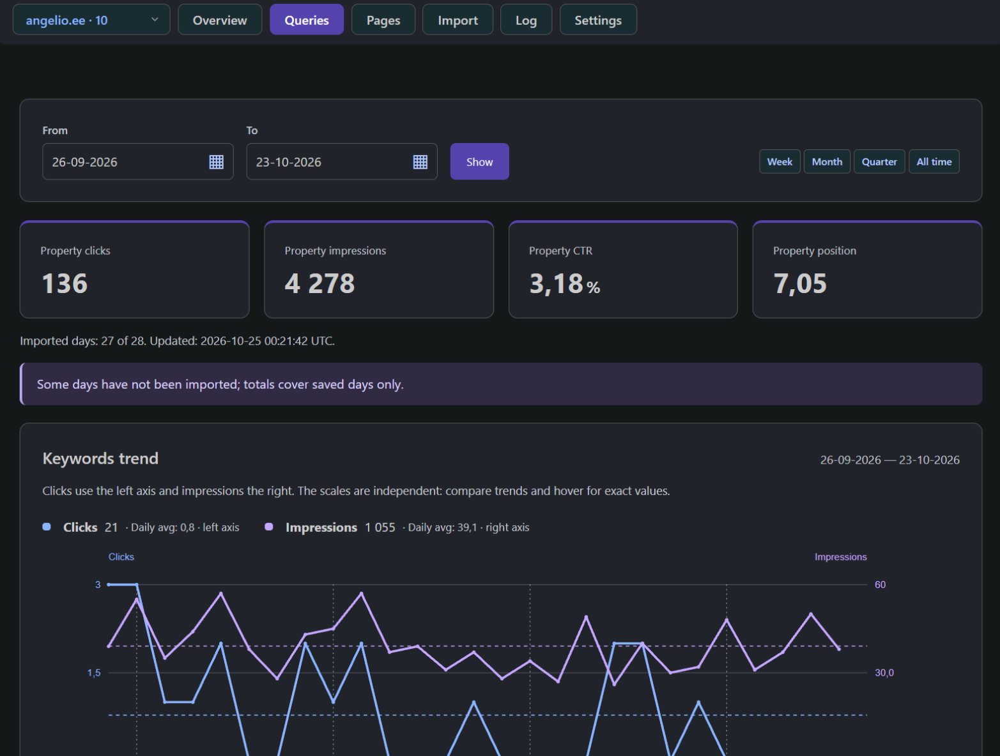
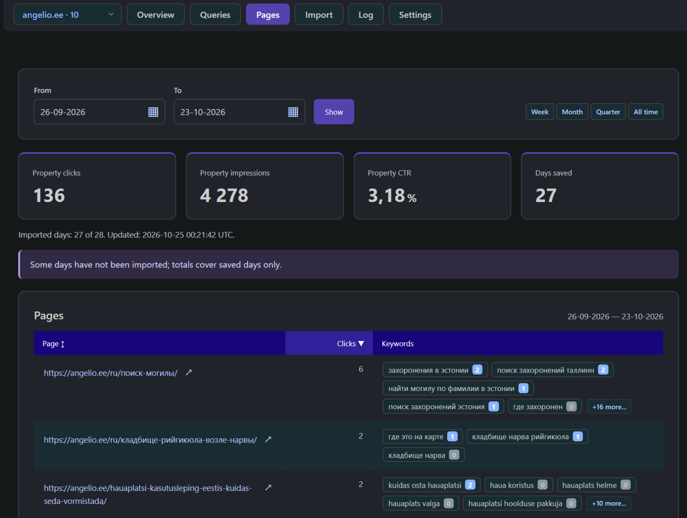
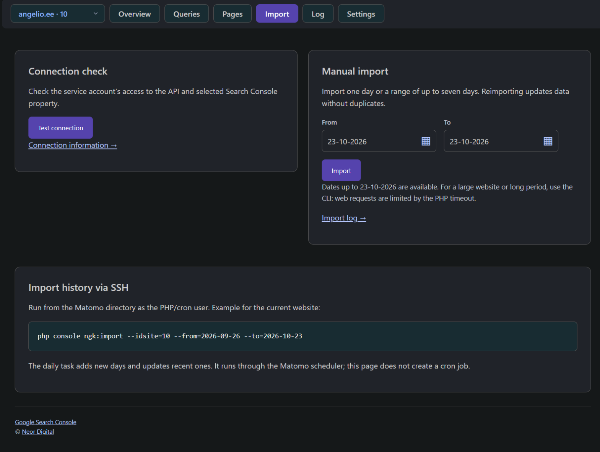

# Discover what brings people to your website from Google

NeorGoogleKeywords brings Google Search Console reports into Matomo, so you can review search visibility, queries and destination pages alongside your website analytics. See which searches earn clicks, find pages worth improving and follow changes over time from one familiar workspace.

It is useful for website owners, content editors and SEO specialists who want to turn search performance data into practical content decisions.

## Overview: see the bigger picture

Start with the two-month trend chart to see how **clicks** and **impressions** change from day to day. Clicks show how often users clicked a Google search result leading to your website; impressions show how often your website appeared in search results.

The chart uses separate scales for these metrics. Hover over the points for exact values, compare trends and look for sustained changes. Gaps identify days without imported data, helping you distinguish missing imports from days with no activity.

Two ranking tables help you decide where to look next:

- **Top 20 queries for the quarter:** discover the searches bringing the most clicks over the last three calendar months through the latest imported day.
- **Top 20 queries for the week:** review the leading searches over the last seven calendar days through that same day.

Sort the tables by query, clicks or impressions, then open an individual query for a closer look. Comparing the weekly and quarterly leaders can help you spot topics gaining attention and identify queries that consistently attract visitors.

**Try this:** review the weekly leaders after publishing new content, then open a relevant query to investigate its daily performance.

## Queries: move from totals to individual search intent

Use **Queries** to analyze search queries together over a selected date range, then drill down into any individual query. The report combines daily trends with sortable metrics: clicks, impressions, click-through rate (CTR) and average position.

For a single query, you can review its trend and see which pages receive clicks from that search. This connects the words people search for with the content they actually reach.

- Find queries with many impressions and relatively few clicks to identify candidates for reviewing page titles and search snippets.
- Sort by average position to identify queries whose rankings deserve closer attention.
- Change the date range to investigate when performance changed.
- Follow a query to its destination pages to check whether the content matches the likely search intent.

**Try this:** choose a query with strong visibility but a low CTR. Review the destination page's title, description and content, then monitor subsequent performance. These metrics help prioritize investigation; they do not establish what caused a change.

## Pages: connect search demand with your content

Open **Pages** to see which website pages receive clicks from Google search queries. Each page lists its total clicks and associated queries, with keyword badges ordered by clicks. Expand additional queries where available or open a query for detailed analysis.

This view helps you understand the role of each page in organic search: which topics it attracts, which queries contribute clicks and whether those searches match the page's purpose.

**Try this:** review an important product or article page. Use its associated queries to find relevant questions your content could answer more clearly, and investigate unexpected queries before making changes.

## Import: automatic and manual updates

Import data **automatically through Matomo's scheduler** or **manually when you need it**. Scheduled daily updates keep your reports current, while manual imports let you load historical data or refresh a selected period.

**Import** lets administrators test the connection and load up to seven days at a time through the web interface. For historical data or larger websites, a CLI command supports longer imports. Reimporting a day updates its data without creating duplicates.

**Log** records import results and errors so administrators can investigate missing data. **Settings** shows connection and configuration information; connection settings are maintained in the server configuration.

You can connect multiple Matomo websites to their corresponding Search Console properties. A search phrases widget is also available under **Referrers → Search Engines and Keywords**. The interface supports English, Russian, French, Spanish, Portuguese, German and Italian, and follows Matomo's language setting.

## Understand the numbers

These reports contain aggregated Search Console statistics. Search clicks and Matomo visits measure different things; queries are not linked to individual Matomo visitors or conversions.

CTR is calculated from clicks and impressions, and average position is weighted by impressions. Google withholds some queries and limits API results, so query totals can differ from property totals. Dates follow `America/Los_Angeles`, and the latest two days are usually not yet available for import. Missing imports affect report coverage; check the imported-day counts when comparing periods.

## Get started

You need Matomo 5.14 or later within the 5.x series, PHP 8.1 or later with cURL and OpenSSL, and access to a Google Search Console property. A Matomo SuperUser configures the connection and imports; report readers need view access to the relevant website.

Follow the [installation instructions](../README.md#installation), then use the [Google Cloud setup guide](google-cloud-setup.md) to create a service account and connect your property. Start with one imported day, confirm the results, then load the history you want to explore.
